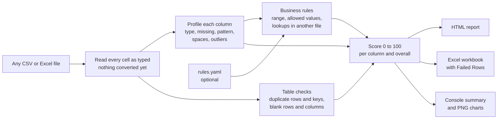
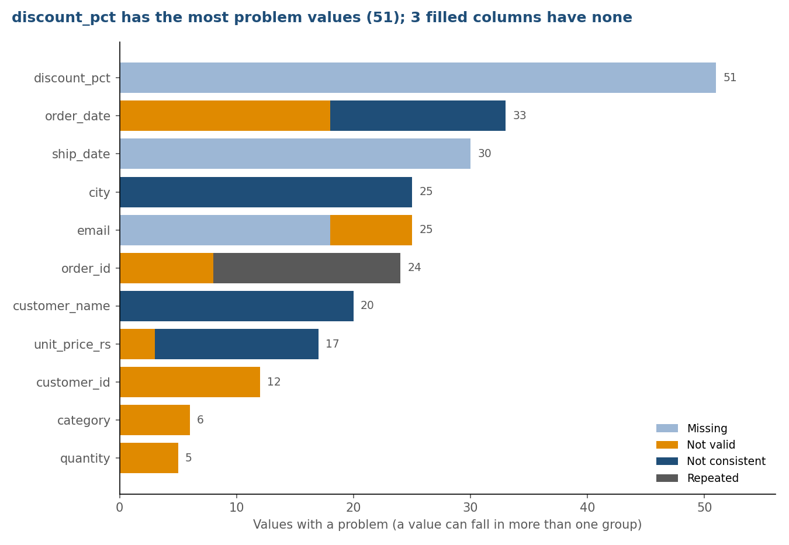
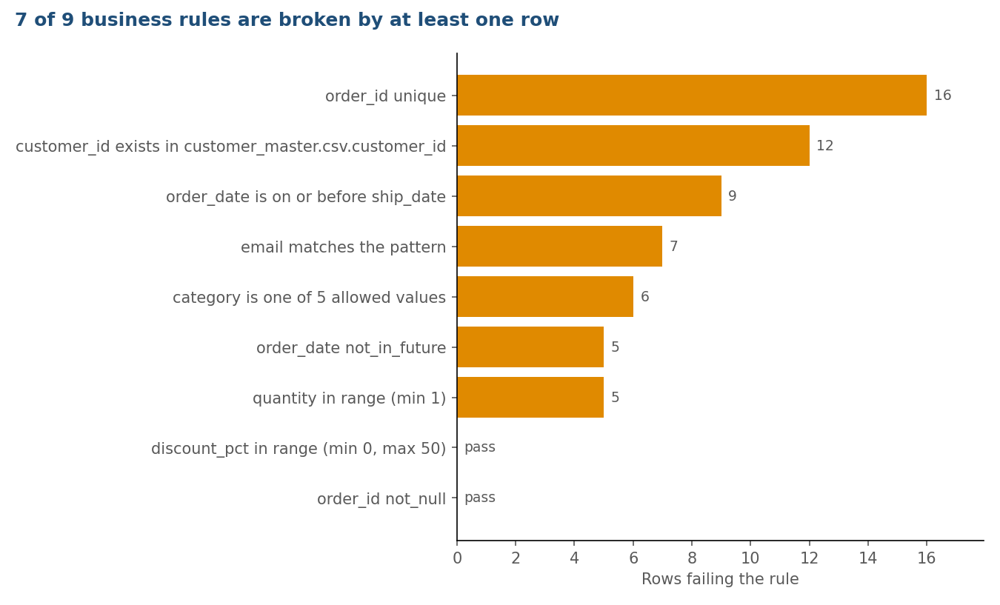
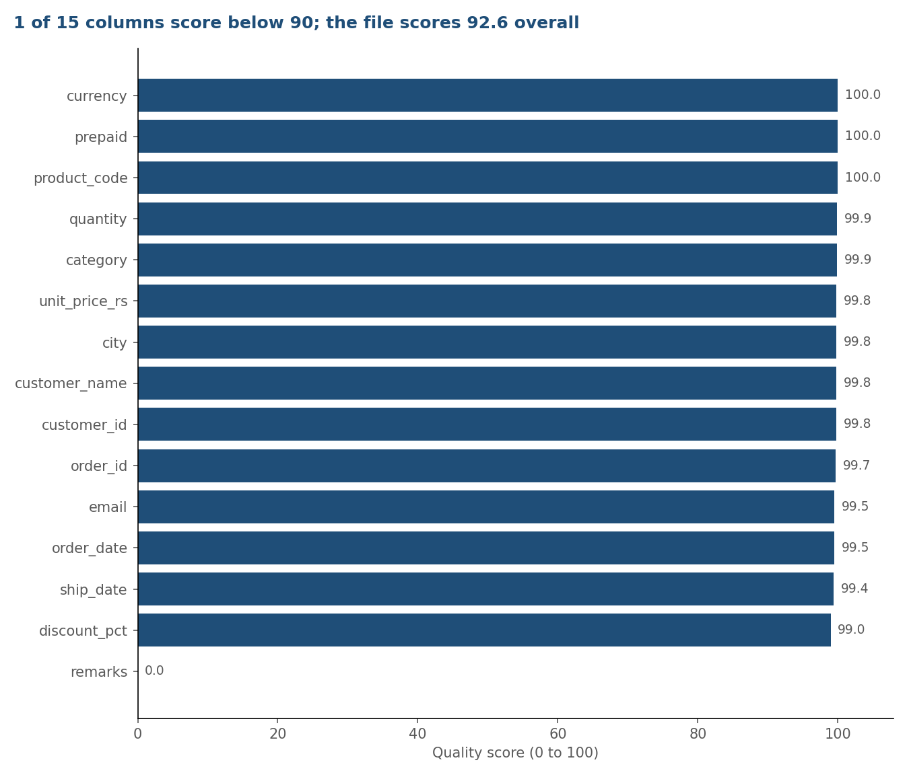

# Data Quality Profiler (Python)

Point it at any CSV or Excel file and it reports what state the data is in before anyone builds a report on it: blank columns, mixed types, duplicates, numbers typed as text, codes in the wrong shape. No setup is needed, and business rules written in a small YAML file can be added when you have them. The result is one HTML report, an Excel workbook listing every failing row, and a quality score from 0 to 100.


---

## The Problem

A new file arrives: an export from the order system, a vendor's spreadsheet, last year's customer list. Before it can be used, someone has to find out what is wrong with it. In practice that means scrolling, filtering a few columns and hoping.

- It is done by eye and differently every time, so the same problem is caught one month and missed the next
- A price typed as `Rs 1,250.00` is text, so the pivot table silently leaves it out of the total
- `Mumbai`, `MUMBAI` and `mumbai` become three cities in the report
- An order number that appears twice doubles the sale
- The problem is usually found after the report has gone out and a number does not tie

## The Solution

```bash
python profile_data.py
```

That profiles the bundled sample. For your own file, give the path; nothing else is required.



Step by step:

1. **Read the file without guessing.** Every cell is kept exactly as written, so `00123`, `Rs 1,250.00` and a trailing space all survive to be inspected.
2. **Work out what each column really holds.** If at least 90% of the filled cells are numbers, the column is a number column and the rest are flagged; the same for dates and yes/no values. The type is decided from the values, never from the column name.
3. **Profile each column**: missing values, distinct values, most common values, range, and the usual *shape* of the values. A shape (or mask) replaces every capital letter with `A`, small letter with `a` and digit with `9`, so `ORD-100234` becomes `AAA-999999`. Values with a different shape stand out.
4. **Check the table**: exact duplicate rows, duplicate keys, completely blank rows and columns.
5. **Apply the rules**, if a YAML file is given.
6. **Score and report.**

## Sample Run

The sample is a made-up order file: 2,013 rows, 15 columns, with 258 problems of 21 kinds planted on purpose (`make_sample_data.py` lists them). This is the real output of the command above:

```
Data quality profile: orders.csv
Rows: 2,013   Columns: 15   Blank rows: 3   Exact duplicate rows: 10   Duplicate keys (order_id): 16
Overall quality score: 92.6 / 100   (completeness 93.0, validity 99.8, uniqueness 99.2, consistency 99.7)

Column         Type                     Missing %  Distinct  Score
order_id       identifier (16 repeats)       0.00     1,994   99.7
order_date     date                          0.00       385   99.5
ship_date      date                          1.49       365   99.4
customer_id    text                          0.00       162   99.8
customer_name  text                          0.00       143   99.8
email          text                          0.90       156   99.5
city           text                          0.00        25   99.8
product_code   text                          0.00        25  100.0
category       text                          0.00         8   99.9
quantity       integer                       0.00        22   99.9
unit_price_rs  decimal                       0.00        36   99.8
discount_pct   integer                       2.54         4   99.0
prepaid        boolean                       0.00         2  100.0
currency       text                          0.00         1  100.0
remarks        empty                       100.00         0    0.0

Issues found: 26   (High 12, Medium 5, Low 9)
  [High  ] remarks: Column is completely empty - 2,010 (100.00%)
  [High  ] (table): Duplicate key (order_id): rows repeating an earlier key - 16 (0.80%)
  [High  ] order_id: Identifier-like column has repeated values - 16 (0.80%)
  [High  ] order_id: Rule failed: order_id unique - 16 (0.80%)
  [High  ] customer_id: Rule failed: customer_id exists in customer_master.csv.customer_id - 12 (0.60%)
  [High  ] (table): Exact duplicate rows (every column the same as an earlier row) - 10 (0.50%)
  [High  ] order_date: Rule failed: order_date is on or before ship_date - 9 (0.46%)
  [High  ] category: Rule failed: category is one of 5 allowed values - 6 (0.30%)
  [High  ] order_date: Rule failed: order_date not_in_future - 5 (0.25%)
  [High  ] quantity: Rule failed: quantity in range (min 1) - 5 (0.25%)
  [High  ] order_date: Values that do not fit the column type (date) - 4 (0.20%)
  [High  ] unit_price_rs: Values that do not fit the column type (decimal) - 3 (0.15%)
  [Medium] city: Same value written with different capital letters - 25 (1.24%)
  [Medium] order_date: Dates stored as text or not in the column's usual format (yyyy-mm-dd) - 15 (0.75%)
  [Medium] unit_price_rs: Numbers stored as text - 14 (0.70%)
  [Medium] order_id: Values that break the usual pattern AAA-999999 - 8 (0.40%)
  [Medium] email: Rule failed: email matches the pattern - 7 (0.35%)
  [Low   ] currency: Column holds a single value on every row - 2,010 (100.00%)
  [Low   ] unit_price_rs: Outliers by the IQR rule (outside -3,451 to 7,349) - 308 (15.32%)
  [Low   ] discount_pct: Missing values - 51 (2.54%)
  [Low   ] ship_date: Missing values - 30 (1.49%)
  [Low   ] customer_name: Leading, trailing or double spaces - 20 (1.00%)
  [Low   ] email: Missing values - 18 (0.90%)
  [Low   ] discount_pct: Placeholder text used instead of a blank (counted as missing) - 11 (0.55%)
  [Low   ] quantity: Outliers by the IQR rule (outside -3.50 to 16.50) - 7 (0.35%)
  [Low   ] (table): Completely blank rows (left out of the column figures) - 3 (0.15%)

Rules: 9 given, 2 passed, 7 failed, 0 could not be run
  [Pass   ] order_id not_null: 0 of 2,010 rows fail
  [Fail   ] order_id unique: 16 of 2,010 rows fail
  [Fail   ] category is one of 5 allowed values: 6 of 2,010 rows fail
  [Fail   ] quantity in range (min 1): 5 of 2,010 rows fail
  [Pass   ] discount_pct in range (min 0, max 50): 0 of 1,959 rows fail
  [Fail   ] email matches the pattern: 7 of 1,992 rows fail
  [Fail   ] order_date not_in_future: 5 of 2,006 rows fail, 4 could not be checked
  [Fail   ] order_date is on or before ship_date: 9 of 1,976 rows fail, 4 could not be checked
  [Fail   ] customer_id exists in customer_master.csv.customer_id: 12 of 2,010 rows fail

HTML report:  output/orders_profile.html
Excel file:   output/orders_profile.xlsx   (501 failed-row entries)
Charts:       images/column_scores.png, images/problem_values.png, images/rule_results.png
Time taken:   3.5 sec
```

**What this says.** Every planted problem was found with the planted count (the end-to-end test asserts this). The 16 duplicate keys are the 6 reused order numbers plus the 10 copied rows. Each issue comes with examples and file row numbers in the report, for instance `'ord-100056' (row 331)` for a badly shaped order number and `'Rs 2,199.00' (row 332)` for a price stored as text.

### Where the problems are



**What this says.** The problems are of different kinds in different columns: `discount_pct` and `ship_date` are mostly a missing-value question (is a blank discount zero, or unknown?), `city` and `customer_name` only need tidying, while `order_id`, `customer_id` and `order_date` hold values that are actually wrong. The empty `remarks` column is left off this chart.

### What the rules found



**What this says.** Seven of the nine rules are broken by a handful of rows each. These are the problems no automatic check can find: `C9008` looks like a perfectly good customer number until it is compared with the customer master.

### The score, and why it should be read with care



**What this says.** Fourteen of the fifteen columns score 99 or more even though almost all of them contain planted errors. That is not a mistake: the score measures the *share* of values with a problem, and here every problem touches about 1% of rows or fewer. Sixteen duplicate order numbers move `order_id` by 0.3 points, yet they would overstate sales. Most of the 7.4 points this file loses come from one empty column. Without the rules and with `--ignore remarks` the same file scores 99.3. So use the score to compare one delivery of a file with the next, and use the issues list to decide what to fix.

## How the Score Is Calculated

Each column gets four part-scores from 0 to 100.

| Part | Weight | What it measures |
|---|---|---|
| Completeness | 35% | Share of rows that have a value. Placeholders such as `N/A` count as missing |
| Validity | 35% | Share of values that fit the column type, follow the usual pattern and pass the rules |
| Uniqueness | 15% | Share of values that do not repeat an earlier one. Used only for the key, identifier-like columns and columns with a `unique` rule |
| Consistency | 15% | Share of values free of stray spaces, mixed capital letters, and numbers or dates written differently from the rest of the column |

```
column score  = weighted average of the parts that apply to the column
overall score = average of the column scores x (1 - share of exact duplicate rows)
```

A value with two validity problems is counted once. Where uniqueness does not apply, the other three weights are scaled up to total 100%. A completely empty column scores 0. Outliers and constant columns are reported but do not change the score, because they are often correct. Example from the run above: `discount_pct` has 51 of 2,010 values missing, so completeness is 97.46 and the column scores (0.35 x 97.46 + 0.35 x 100 + 0.15 x 100) / 0.85 = 99.0.

The weights are the `WEIGHTS` setting at the top of `profile_data.py`. They are a reasonable choice, not a standard. The score is a summary of what these checks found; it is not a guarantee that the data is right.

## What It Checks

| Check | Details |
|---|---|
| Column type | integer, decimal, date, text, boolean or identifier, decided from the values |
| Missing values | Blanks, plus placeholders (`N/A`, `null`, `-`, `?`) which are counted as missing and reported separately |
| Values that do not fit | `TBC` in a price column, `31/02/2026` in a date column |
| Numbers stored as text | `Rs 1,250.00`, `1,25,000`; in Excel also a number typed into a text cell |
| Dates in another format | `25/12/2025` in a column of `2025-12-25` dates; in Excel also dates typed as text |
| Usual pattern | The shape most values share (`AAA-9999`), and the values that break it |
| Identifier-like columns | Nearly all values different and code-shaped; reported as unique or with the number of repeats |
| Spaces and capital letters | Leading, trailing and double spaces; `MUMBAI` next to `Mumbai` |
| Numbers | Min, max, mean, median; outliers by the IQR rule (more than 1.5 times the interquartile range beyond the quartiles) |
| Dates and text | Date range; shortest and longest text |
| Table | Exact duplicate rows, duplicate keys, blank rows, empty columns, constant columns |
| Bad input | A rule that names a missing column, or a file that cannot be read, is reported with the reason and never skipped quietly |

**Rules available in the YAML file**

| Check | Example | Fails when |
|---|---|---|
| `not_null` | `{column: order_id, check: not_null}` | the value is blank |
| `unique` | `{column: order_id, check: unique}` | the value repeats an earlier row |
| `allowed_values` | `values: [Retail, Wholesale]` (optional `ignore_case: true`) | the value is not in the list |
| `range` | `min: 1`, `max: 500` (numbers or dates) | the value is outside the range |
| `regex` | `pattern: '[A-Z]{3}-\d{4}'` | the whole value does not match |
| `not_in_future` | uses today, or `as_of` in the file | the date is after today |
| `less_or_equal` | `other: ship_date` | column A is greater than column B |
| `exists_in` | `file: customer_master.csv`, `other: customer_id` | the value is not in that column of the other file |

Every rule can also carry a `name` and a `severity` (High, Medium or Low). The bundled [`data/rules.yaml`](data/rules.yaml) uses all eight checks.

## How to Use

```bash
pip install -r requirements.txt
```

Profile any file with no configuration:

```bash
python profile_data.py "C:/Reports/vendor_list.xlsx"
```

Say which column should identify a row:

```bash
python profile_data.py sales.csv --key invoice_no
```

Add business rules:

```bash
python profile_data.py sales.csv --rules sales_rules.yaml --out reports
```

Recreate the sample data and the README charts:

```bash
python make_sample_data.py
```

```bash
python profile_data.py --charts-dir images
```

Run the tests:

```bash
python -m pytest
```

| Option | Default | Description |
|---|---|---|
| `file` | `data/orders.csv` | CSV, TXT, TSV, XLSX or XLSM file. The separator (comma, semicolon, tab, pipe) is detected |
| `--rules` | none (sample rules for the sample file) | YAML file of business rules |
| `--key` | from the rules file | Column that should identify a row; several columns separated by commas |
| `--sheet` | first sheet | Excel sheet name |
| `--out` | `output` | Folder for the HTML report and the Excel file |
| `--charts-dir` | same as `--out` | Folder for the PNG charts |
| `--ignore` | none | Columns to leave out, separated by commas |
| `--as-of` | today | The date `not_in_future` compares with |
| `--date-order` | `dmy` | How to read `03/04/2026`: `dmy` is 3 April, `mdy` is 4 March |
| `--type-threshold` | `0.90` | Share of values that must agree before a column type is assigned |
| `--pattern-threshold` | `0.90` | Share of values that must follow one shape before the others are flagged |
| `--iqr-k` | `1.5` | Multiplier for the outlier fences |
| `--top` | `5` | Most common values kept per column |

**Outputs**

| File | Contents |
|---|---|
| `<file>_profile.html` | One self-contained page (no internet needed): summary panel, columns table with bars, issues by severity, rule results, how the score works |
| `<file>_profile.xlsx` | Sheets `Summary`, `Columns`, `Issues`, `Rules`, and `Failed Rows` (row number, column, value and the check it failed) |
| `column_scores.png`, `problem_values.png`, `rule_results.png` | The charts shown above |

## Notes and Limits

- **The sample data is generated**, not real. Names, customers, products and prices are made up, and the problems were planted in known numbers so the tool can be tested against them. Real files are messier and the profiler will not catch everything in them.
- **It finds what looks wrong, not what is wrong.** A valid-looking customer number that belongs to the wrong customer passes every check. Rules help, but only for the rules you write.
- **Outliers are a prompt to look, not errors.** The IQR rule flags 308 prices in the sample, and all of them are genuine prices of expensive products; only the 7 extreme quantities were planted. Price columns are naturally lopsided, which is why outliers do not affect the score.
- **Ambiguous dates.** `03/04/2026` is read day first unless `--date-order mdy` is given. The tool cannot tell which was meant.
- **Thresholds are judgement calls.** A column that is 85% numbers is treated as text with mixed content, not as a number column; change `--type-threshold` if that does not suit the file.
- **A key made of several columns** is checked and reported for duplicates, but only a single-column key feeds the uniqueness score.
- **Size.** The whole file is read into memory. It is meant for files up to a few hundred thousand rows; the old `.xls` format is not supported.

## Project Structure

```
data-quality-profiler/
├── profile_data.py             # the profiler: checks, rules, score, reports
├── make_sample_data.py         # recreates the sample files (fixed seed, planted problems)
├── templates/
│   └── report.html             # Jinja2 template for the HTML report (inline CSS)
├── data/
│   ├── orders.csv              # 2,013 sample orders with 258 planted problems
│   ├── customer_master.csv     # 150 customers, used by the exists_in rule
│   └── rules.yaml              # sample business rules
├── tests/
│   └── test_profiler.py        # 9 tests
├── images/                     # charts shown in this README
├── requirements.txt
├── README.md
└── LICENSE
```

## Roadmap

- [ ] Compare two profiles of the same file (this month against last month) and report what changed
- [ ] Rules across rows, such as "the total of the line amounts equals the invoice amount"
- [ ] Read straight from a SQL table as well as from files

---

**Author:** [Swaminathan Narayanan](https://www.linkedin.com/in/swaminathan-narayanan-9781a7154/): Data Analytics | Excel & VBA Automation | Python | SQL | Power BI
